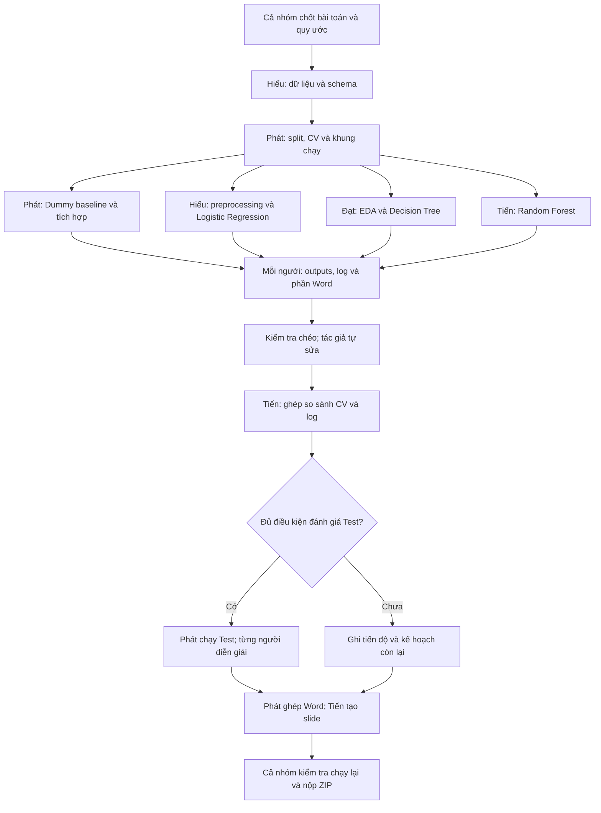

# Student Dropout — Báo cáo tiến độ giữa kỳ

**Đề tài:** Dự đoán nguy cơ bỏ học và kết quả học tập của sinh viên.  
**Nhóm:** 10 · **Lớp:** DCT124C1 · **Thành viên:** 4.  
**Hạn Classroom:** 08/11/2026, 23:59 (giờ Việt Nam). Hạn nội bộ đề xuất: 20:00 cùng ngày.

## Tài liệu làm việc

- [Bảng phân công, tiến độ và khối lượng](https://docs.google.com/spreadsheets/d/1ifjw4lbfHyAjlfEMAZqaTczeFblSxyRKLJEwAfjOrZ0/edit)
- [Google Doc — khung báo cáo để cả nhóm viết](https://docs.google.com/document/d/1ta0YKkwCw14sy-P3lps2_znJ8xPgoIDGoJm4RRNdaKs/edit)
- [Nguồn dữ liệu UCI](https://archive.ics.uci.edu/dataset/697/predict+students+dropout+and+academic+success)
- [Notebook EDA và Decision Tree hiện có](ThanhDat_EDA_DecisionTree.ipynb)

README này mô tả workflow và kế hoạch bàn giao. Những file, bước chạy và kết quả dự kiến bên dưới **không được xem là đã triển khai**. Notebook hiện có ghi rằng outputs được giữ từ bản gốc và bản tách chưa chạy lại vì thiếu dữ liệu; cần xác minh trước khi sử dụng số liệu.

## Phân công cân bằng

Dùng **40 điểm khối lượng tương đối**, chia 10 điểm cho mỗi gói để lập kế hoạch. Đây không phải điểm môn học, số giờ cam kết hoặc xác nhận 25% đóng góp thực tế. Đóng góp khi nộp phải dựa vào sản phẩm và công việc thực hiện.

| Thành viên | Triển khai và phân tích | Viết báo cáo | Kiểm tra / phối hợp | Tổng dự kiến |
| --- | --- | --- | --- | --- |
| **Dương Gia Phát** | Pipeline, split/CV, runner, Dummy baseline: **4**; tích hợp và kiểm tra tái lập: **3** | Chương 1 và 3: **2** | Ghép định dạng Word: **1**; kiểm tra RF trong gói kiểm chứng | **10 / 40** |
| **Lê Văn Hiếu** | Dữ liệu và preprocessing: **4**; Logistic Regression và phân tích: **3** | 2.1, 2.3, 4.1 và đoạn LR ở Chương 5: **2** | Kiểm tra runner/baseline của Phát: **1** | **10 / 40** |
| **Văn Nguyễn Thành Đạt** | EDA và insights: **4**; Decision Tree, tuning và phân tích: **3** | 2.2, 4.2 và đoạn DT ở Chương 5: **2** | Kiểm tra preprocessing/LR của Hiếu: **1** | **10 / 40** |
| **Cái Trần Minh Tiến** | Random Forest, tuning nhỏ: **4**; ghép log và bảng so sánh: **3** | 4.3 và kết luận chung Chương 5: **2** | Kiểm tra EDA/DT của Đạt, tạo slide từ Word: **1** | **10 / 40** |

**Ranh giới trách nhiệm:**

- Ai chạy mô hình thì tự ghi log, lưu outputs, giải thích lỗi và viết phần mô hình của mình.
- Tiến ghép log, bảng kết quả và kết luận so sánh; từng tác giả cung cấp sẵn phân tích mô hình mình.
- Phát làm baseline, khung chạy, tích hợp và ghép định dạng; từng người tự sửa nội dung/code của mình.
- Từng người tự ghi đóng góp, khó khăn và kế hoạch ở Chương 6, tự bổ sung tài liệu tham khảo.
- Slide tạo từ bản Word đã chốt là khâu nhẹ, không phải một gói chuyên môn riêng.
- Nếu một gói phát sinh nhiều việc, cả nhóm chuyển một đầu việc cụ thể sang người còn khả năng trước khi nhận thêm mô hình hay tính năng.

## Workflow trực quan



### Đầu vào, đầu ra và thứ tự bàn giao

| Bước | Chủ trì | Việc thực hiện | Đầu ra / điều kiện chuyển bước |
| --- | --- | --- | --- |
| 1. Chốt quy ước | Cả nhóm, Phát điều phối | Chốt thời điểm dự đoán, nhóm đặc trưng, nhãn, split/CV, metrics và môi trường | Một cấu hình thống nhất; 4 người xác nhận phạm vi |
| 2. Dữ liệu gốc | Hiếu | Tải UCI; kiểm tra phiên bản, dòng/cột, thiếu/trùng; viết hàm đọc | Cùng dataset và thứ tự dòng; bảng thuộc tính |
| 3. Khung thực nghiệm | Phát | Lưu chỉ số split; tạo CV/runner và DummyClassifier | Notebook các mô hình dùng cùng dòng Train/Test và fold |
| 4. Làm song song | Hiếu, Đạt, Tiến | Preprocessing/LR; EDA/DT; RF; Phát hoàn thiện baseline và tích hợp | Code, metrics, hình, log và nội dung Word của từng gói |
| 5. Bàn giao và kiểm tra chéo | Cả nhóm | Nhận đủ sản phẩm; người kiểm tra phản hồi, tác giả tự sửa | Không giao code/hình chưa có nhận xét cho người khác viết lại |
| 6. So sánh | Tiến tổng hợp | Ghép bảng CV, log và các đoạn phân tích do tác giả gửi | Chốt cấu hình theo CV; phân biệt CV, OOF và Test |
| 7. Test nếu sẵn sàng | Phát chạy, từng người kiểm tra | Fit pipeline trên Train rồi đánh giá Test cho cấu hình đã chốt | Bảng Test riêng; không chỉnh mô hình theo Test |
| 8. Báo cáo và slide | Tất cả tự viết; Phát ghép; Tiến tạo slide | Chốt các mục trong Google Doc, đối chiếu số liệu | Word và slide khớp code, log và hình |
| 9. Tái lập và nộp | Cả nhóm, nhóm trưởng nộp | Chạy lại qua README; mỗi tác giả sửa phần mình; ghép ZIP | Đủ sản phẩm, đọc được, ghi đúng tiến độ thực tế |

EDA phục vụ lựa chọn đặc trưng thực hiện trên Train. Hiếu cung cấp hàm tạo preprocessing; encoder/scaler phải được fit **bên trong Pipeline của từng fold**, không fit trên toàn bộ dữ liệu trước CV.

### Kiểm tra chéo

**Phát → Tiến → Đạt → Hiếu → Phát**: người bên trái kiểm tra phần của người bên phải.

| Người kiểm tra | Phần cần kiểm tra |
| --- | --- |
| Phát | Random Forest của Tiến |
| Tiến | EDA và Decision Tree của Đạt |
| Đạt | Dữ liệu, preprocessing và Logistic Regression của Hiếu |
| Hiếu | Split, runner và Dummy baseline của Phát |

Người kiểm tra xác nhận đủ code, Word, log và hình, không nhận thay trách nhiệm sửa mọi lỗi của tác giả.

## Quy ước thực nghiệm

Cấu hình theo notebook hiện có, cần cả nhóm xác nhận trước khi chạy:

- Phân lớp **Dropout / Enrolled / Graduate**; chốt bộ đặc trưng theo **thời điểm dự đoán**. Dùng dữ liệu HK2 thì không gọi là dự đoán ngay lúc nhập học.
- Train/Test **80/20**, `stratify=y`, `random_state=42`; lưu chỉ số dòng và giữ thứ tự Train.
- `StratifiedKFold(n_splits=5, shuffle=True, random_state=42)` trên Train.
- Chọn cấu hình bằng **Macro-F1 CV**; báo cáo thêm Accuracy, Recall từng lớp và Confusion Matrix.
- Ghi rõ **CV mean/std**, **OOF** hay **Test**; không đặt các giá trị khác cách tính cạnh nhau như cùng một thước đo.
- Tuning trên Train/CV. Best CV sau tìm tham số là kết quả lựa chọn, chưa phải đánh giá độc lập.
- Giữ Test riêng; dùng sau khi chốt cấu hình. Nếu giữa kỳ chưa làm tới, ghi rõ kế hoạch còn lại.
- Có baseline và ít nhất hai mô hình phù hợp; hiện chia Logistic Regression, Decision Tree và Random Forest. Decision Tree là phần tuning chính; RF chỉ thử lưới nhỏ trong phạm vi gói việc.

## Experiment log: ai chạy, người đó ghi

**Trước chạy:** đặt câu hỏi/giả thuyết và ghi cấu hình.  
**Sau chạy:** bổ sung outputs, quan sát, metrics, kết luận và link kết quả. Ghi cả lần lỗi hoặc không cải thiện.

Schema dùng chung đề xuất:

```text
run_id, owner, timestamp, objective_hypothesis,
data_version, code_commit, model, features, preprocessing,
params, split_id, seed, cv,
metrics, observations, conclusion, output_link
```

Mã ví dụ để đặt tên, không phải các lần chạy đã được thực hiện: `PHAT_DUMMY_001`, `HIEU_LR_001`, `DAT_DT_001`, `TIEN_RF_001`.

Khi GridSearch, ghi một bản log mô tả lần tìm kiếm và xuất đầy đủ `cv_results.csv` cho các cấu hình; không cần chép tay từng fold. Tiến ghép các log do từng người cung cấp thành file chung.

## Bố cục Google Doc

Khung Doc chỉ gồm tiêu đề, chương/mục và khoảng trống để viết. **Không thêm tên người vào bất kỳ tiêu đề chương/mục nào.** Phân công chỉ đặt trong bảng công việc và bảng đóng góp thực tế.

| Chương / mục | Nội dung | Người viết trong bảng phân công |
| --- | --- | --- |
| Chương 1. Giới thiệu bài toán | Bối cảnh; mục tiêu; Input/Output; phạm vi và thời điểm dự đoán | Phát |
| 2.1. Nguồn dữ liệu, thuộc tính và biến mục tiêu | Nguồn, schema, target, ví dụ | Hiếu |
| 2.2. Khám phá và trực quan hóa dữ liệu | EDA và insights | Đạt |
| 2.3. Tiền xử lý và xây dựng đặc trưng | Kiểm tra và biến đổi dữ liệu | Hiếu |
| Chương 3. Thiết kế thực nghiệm | Pipeline; split/CV; metrics; baseline; leakage/tái lập | Phát |
| 4.1. Logistic Regression | Cấu hình, cách chạy và kết quả LR | Hiếu |
| 4.2. Decision Tree | Cây ban đầu, tuning và phân tích | Đạt |
| 4.3. Random Forest | Cấu hình, tuning nhỏ và phân tích | Tiến |
| Chương 5. Kết quả bước đầu và thảo luận | Bảng chung; lỗi; overfitting; diễn giải; hạn chế | Mỗi người viết mô hình mình; Tiến ghép kết luận |
| Chương 6. Tiến độ và kế hoạch | Đã làm; khó khăn; còn lại; kế hoạch; đóng góp | Mỗi người tự điền; Phát ghép bảng |
| Tài liệu tham khảo và phụ lục | Nguồn; log; hướng dẫn; hình bổ sung | Mỗi người bổ sung phần mình |

Chương 2 có tên **Dữ liệu và tiền xử lý**; Chương 4 có tên **Xây dựng mô hình**. Mỗi phần cá nhân cần có cách làm, cấu hình, bảng/hình, nhận xét, hạn chế và nguồn. Không đưa điểm số chưa chạy xác minh vào báo cáo.

## Tổ chức file và GitHub

Cấu trúc **đề xuất để triển khai**, không phải xác nhận những đường dẫn này đã tồn tại:

| Đường dẫn dự kiến trong FinalExam | Nội dung |
| --- | --- |
| `data/` | Dữ liệu gốc hoặc hướng dẫn tải |
| `configs/` | Split/CV, seed, feature set và cấu hình chung |
| `src/` | Hàm đọc, preprocessing, runner và đánh giá |
| `notebooks/` | EDA và các notebook mô hình |
| `results/<run_id>/` | Params, metrics, dự đoán và kết quả từng lần chạy |
| `logs/` | Log cá nhân và experiment_log.csv chung |
| `figures/` | Hình gốc |
| `report/` | Bản Word/slide xuất từ tài liệu chung |
| `requirements.txt` | Phiên bản thư viện phục vụ tái lập |

Notebook hiện có giữ nguyên đường dẫn cho đến khi nhóm chủ động thống nhất di chuyển.

- Nhánh đề xuất: `phat/integration`, `hieu/data-logreg`, `dat/eda-tree`, `tien/random-forest`.
- Cập nhật phiên bản chung trước khi làm; commit theo đầu việc; tránh cùng sửa một notebook.
- Bàn giao bằng link commit/PR và link outputs trên tab **Phân công**.
- Khi đổi dữ liệu, split hay preprocessing chung: báo nhóm, cập nhật phiên bản và chạy lại các mô hình bị ảnh hưởng.
- Tác giả hoàn thiện hướng dẫn chạy cho phần mình; Phát ghép thành hướng dẫn chung khi code đã tích hợp. README này không đưa lệnh chạy giả cho các file chưa được tạo.

## Mốc bàn giao đề xuất

| Hạn | Sản phẩm |
| --- | --- |
| 01/11 | Chốt bài toán và quy ước |
| 03/11 | Dữ liệu, EDA, preprocessing, runner/baseline |
| 04/11 | Các mô hình, hình, metrics và log cá nhân |
| 05/11 | Kiểm tra chéo, bảng so sánh và nội dung Word |
| 06/11 | Chốt Word; tạo slide từ Word |
| 07/11 | Chạy lại từ đầu và tập trình bày |
| 08/11 trước 20:00 | Nộp nội bộ; hạn Classroom 23:59 |

## Hoàn thành và dừng

Chỉ đánh dấu **Hoàn thành** khi phần được giao chạy lại được, log–hình–Word khớp nhau, có nhận xét và đủ link bàn giao. Để rõ phần **chưa thực hiện** trong báo cáo giữa kỳ.

Không thêm mô hình/tính năng chỉ để tăng số lượng. Khi đủ mục tiêu, thực nghiệm cần thiết và bằng chứng đã thống nhất, chốt báo cáo.

Gói nộp **Nhom10_StudentDropout_GiuaKy.zip** gồm:

- Báo cáo `.docx` và slide `.pptx`.
- Source `.py`/`.ipynb`, cấu hình và README chạy lại.
- Experiment log và hình gốc.
- Dataset hoặc đường dẫn tải; mô hình đã huấn luyện nếu có.
- Bảng tiến độ, đóng góp thực tế và kế hoạch giai đoạn tiếp theo.
