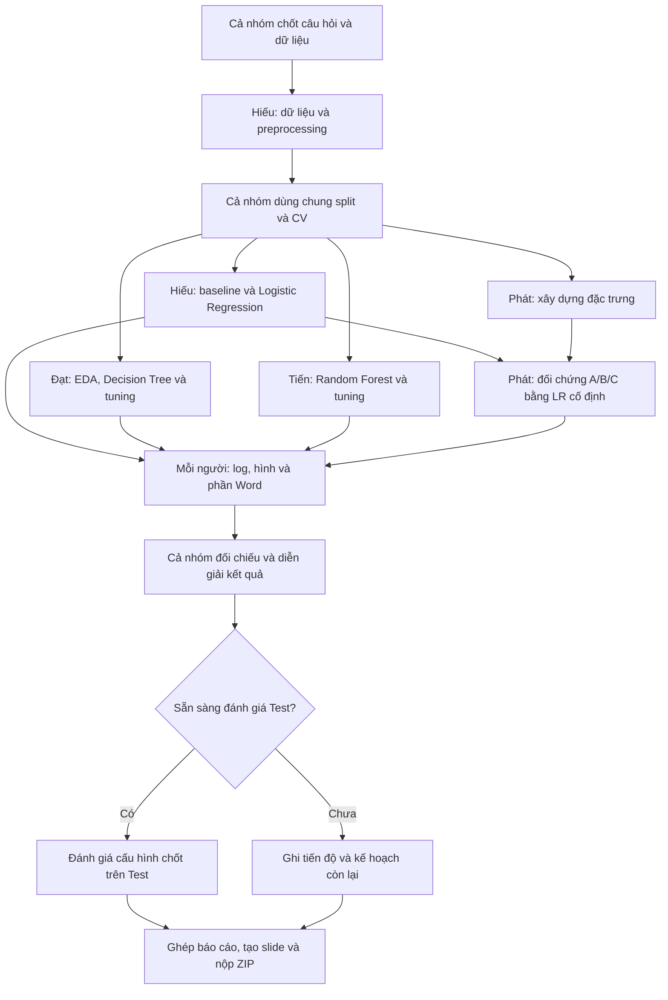

# Student Dropout — Báo cáo tiến độ giữa kỳ

**Đề tài:** Dự đoán nguy cơ bỏ học và kết quả học tập của sinh viên.  
**Nhóm:** 10 · **Lớp:** DCT124C1 · **Thành viên:** 4.  
**Hạn Classroom:** 08/11/2026, 23:59 giờ Việt Nam. Hạn nội bộ đề xuất: 20:00.

## Tài liệu làm việc

- [Phân công, khối lượng và workflow](https://docs.google.com/spreadsheets/d/1ifjw4lbfHyAjlfEMAZqaTczeFblSxyRKLJEwAfjOrZ0/edit)
- [Google Doc — khung chương và mục để cả nhóm viết](https://docs.google.com/document/d/1ta0YKkwCw14sy-P3lps2_znJ8xPgoIDGoJm4RRNdaKs/edit)
- [Nguồn dữ liệu UCI](https://archive.ics.uci.edu/dataset/697/predict+students+dropout+and+academic+success)
- [Notebook EDA và Decision Tree hiện có](ThanhDat_EDA_DecisionTree.ipynb)

Đây là kế hoạch triển khai và bàn giao. Notebook hiện có ghi rằng outputs được giữ từ bản gốc, bản tách chưa chạy lại vì thiếu dữ liệu. Các thử nghiệm, kết quả và đường dẫn đề xuất bên dưới chỉ được xác nhận hoàn thành sau khi thực hiện và lưu bằng chứng.

## Nguyên tắc chia công việc

Cân khối lượng theo **kỹ thuật, thiết kế thực nghiệm và phân tích kết quả**. Mỗi người có một gói chuyên môn riêng, tự viết nội dung báo cáo và log của mình.

**Phân chia, tổng hợp, ghép file, tích hợp, kiểm tra chạy lại, tạo slide và đóng ZIP là việc hỗ trợ; không tính thành nhiệm vụ chuyên môn để cân khối lượng.** Không đặt điểm hoặc phần trăm đóng góp giả định. Cả nhóm điều chỉnh phạm vi theo sản phẩm và công việc thực tế.

## Bốn gói chuyên môn

| Thành viên | Công việc chuyên môn | Thực nghiệm chuyên môn được giao | Sản phẩm |
| --- | --- | --- | --- |
| **Dương Gia Phát** | **Feature engineering và ablation** | Xây dựng đặc trưng có ý nghĩa; so sánh A/B/C bằng cùng mô hình/cấu hình/fold; phân tích tác động đặc trưng và giới hạn thời điểm dữ liệu | Hàm tạo đặc trưng, notebook đối chứng, log, bảng/biểu đồ chênh lệch, Word 2.5, 3.4 và 4.6; thiết kế Chương 3 và bối cảnh Chương 1 |
| **Lê Văn Hiếu** | **Dữ liệu, preprocessing, baseline và Logistic Regression** | Kiểm tra schema/thiếu/trùng; encoding/scaling đúng trong CV; Dummy vs LR; lỗi theo lớp và train–validation gap | Dữ liệu/link, bảng thuộc tính, preprocessing, notebook baseline/LR, log/hình; Word 2.2, 3.1, 3.3, 4.1; baseline cho 3.7 |
| **Văn Nguyễn Thành Đạt** | **EDA, Decision Tree và tuning** | EDA trả lời câu hỏi dữ liệu; cây ban đầu vs tuning; phân tích overfitting, lỗi theo lớp, cấu trúc hoặc đặc trưng cây | Notebook EDA/DT, hình/insights, bảng tuning, log và phân tích; Word 2.3, 3.2 và 4.2 |
| **Cái Trần Minh Tiến** | **Random Forest, tuning và phân tích mô hình** | RF ban đầu vs tuning có giới hạn; độ ổn định theo fold; lỗi từng lớp; tầm quan trọng đặc trưng; ưu/nhược điểm so với LR/DT | Notebook RF, log, bảng tuning/metrics và hình; Word 2.4, 4.3 và đoạn phân tích RF ở Chương 4 |

Từng người tự viết đoạn phân tích mô hình/thực nghiệm mình ở Chương 4, tự ghi đóng góp và kế hoạch ở Chương 6, tự bổ sung nguồn. Không chỉ gọi `fit/predict` rồi báo Accuracy; mỗi gói phải có câu hỏi, thực nghiệm so sánh và nhận xét dựa trên bằng chứng.

### Phần chuyên môn của Phát: đối chứng đặc trưng

Câu hỏi nghiên cứu:

1. Bỏ nhóm thông tin học kỳ 2 làm hiệu năng thay đổi thế nào?
2. Đặc trưng được xây dựng thêm có cải thiện hiệu năng hoặc độ ổn định so với dữ liệu gốc không?

| Cấu hình | Bộ đặc trưng | So sánh |
| --- | --- | --- |
| **A** | Bộ đặc trưng gốc đã thống nhất | Mốc đối chứng |
| **B** | A bỏ toàn bộ cột học kỳ 2 | A–B: ảnh hưởng của nhóm thông tin HK2 |
| **C** | A cộng các đặc trưng mới có giải thích | C–A: giá trị bổ sung của feature engineering |

Ứng viên đặc trưng C: tỷ lệ học phần qua môn/đăng ký của HK1 và HK2; chênh lệch điểm HK2–HK1. Phải giải thích công thức, xử lý mẫu số bằng 0, kiểm tra tính hợp lệ và lưu danh sách cột của từng cấu hình.

Hiếu bàn giao cấu hình Logistic Regression làm mô hình cố định. Phát giữ nguyên model, tham số, preprocessing cho các cột gốc, Train/Test và fold; chỉ thay feature set A/B/C. Ghi Macro-F1, Recall từng lớp, train–validation gap, mean/std và chênh lệch theo fold; lưu log và giải thích khi kết quả không cải thiện.

B chỉ loại nhóm HK2, không chứng minh toàn bộ biến còn lại có sẵn lúc nhập học. C dùng HK2 nên cũng chỉ phù hợp thời điểm có HK2. Không diễn giải chênh lệch này thành quan hệ nhân quả hoặc hiệu quả triển khai cảnh báo sớm khi chưa xác minh thời điểm dữ liệu.

## Workflow trực quan



### Thứ tự và điều kiện bàn giao

| Bước | Người làm | Đầu ra / điều kiện |
| --- | --- | --- |
| 1. Chốt bài toán | Cả nhóm | Mục tiêu, nhãn, thời điểm dự đoán, feature set, split/CV và metrics thống nhất |
| 2. Dữ liệu và khung dùng chung | Hiếu và cả nhóm | Cùng dữ liệu, thứ tự dòng, chỉ số split và fold; preprocessing fit trong Pipeline |
| 3. Làm chuyên môn | Hiếu, Đạt, Tiến, Phát | Mỗi người làm gói ở bảng trên; Phát nhận LR cố định từ Hiếu để chạy đối chứng |
| 4. Ghi log và viết | Mỗi người | Trước chạy ghi giả thuyết/cấu hình; sau chạy ghi outputs/kết luận; viết ngay phần Word |
| 5. Phân tích | Mỗi người | Giải thích lỗi/kết quả mô hình mình; Phát giải thích A–B và C–A; số liệu có link truy vết |
| 6. Đánh giá Test nếu sẵn sàng | Cả nhóm | Chốt cấu hình bằng CV trước; fit trên Train, đánh giá Test; không tuning theo Test |
| 7. Hoàn thiện sản phẩm | Cả nhóm | Ghép các phần đã viết, đối chiếu code–log–hình–Word, xuất slide/ZIP và nộp |

Các bước thiết lập chung, kiểm tra chéo và hoàn thiện sản phẩm phục vụ chất lượng, không dùng để bù cho việc thiếu nhiệm vụ chuyên môn.

## Quy ước thực nghiệm

Cấu hình theo notebook hiện có, cần cả nhóm xác nhận:

- Target: **Dropout / Enrolled / Graduate**; chốt features theo thời điểm dự đoán.
- Train/Test **80/20**, `stratify=y`, `random_state=42`; lưu chỉ số dòng và giữ thứ tự Train.
- `StratifiedKFold(n_splits=5, shuffle=True, random_state=42)` trên Train; cùng fold cho các thử nghiệm.
- Chọn cấu hình bằng **Macro-F1 CV**; bổ sung Accuracy, Recall từng lớp và Confusion Matrix.
- Ghi rõ **CV mean/std**, **OOF** hoặc **Test**; không trộn các cách tính khi so sánh.
- Encoder/scaler và mọi bước học từ dữ liệu được fit bên trong từng fold. EDA phục vụ lựa chọn đặc trưng thực hiện trên Train.
- Tuning trên Train/CV. Best CV từ tìm tham số là kết quả lựa chọn, chưa phải đánh giá độc lập.
- Giữ Test riêng cho cấu hình đã chốt. Nếu giữa kỳ chưa đến bước này, ghi rõ phần còn lại.
- Duy trì baseline, ba mô hình hiện tại và thí nghiệm đối chứng; không thêm thuật toán chỉ để chia đủ người.

## Experiment log

**Ai chạy, người đó ghi**; Tiến chỉ ghép các file, không ghi hộ.

```text
run_id, owner, timestamp, objective_hypothesis,
data_version, code_commit, model, features, preprocessing,
params, split_id, seed, cv,
metrics, observations, conclusion, output_link
```

- **Phát:** log A/B/C và kết luận về đặc trưng.
- **Hiếu:** Dummy baseline và Logistic Regression.
- **Đạt:** Decision Tree ban đầu, tuning và kết luận.
- **Tiến:** Random Forest ban đầu, tuning và kết luận.

Mã mẫu để đặt tên, chưa phải các run đã thực hiện: `PHAT_FE_A_001`, `PHAT_FE_B_001`, `PHAT_FE_C_001`, `HIEU_LR_001`, `DAT_DT_001`, `TIEN_RF_001`.

Ghi cả lần lỗi hoặc không cải thiện. GridSearch có thể ghi một log của lần tìm kiếm và xuất `cv_results.csv` đầy đủ, không cần chép tay từng fold.

## Bố cục báo cáo

Khung bám **5 chương trong tài liệu cuối kỳ**, bổ sung **Chương 6** để phản ánh tiến độ giữa kỳ. Google Doc chỉ có tiêu đề và khoảng trống, chưa có nội dung/kết quả. **Không đặt tên thành viên trong tiêu đề chương/mục**; tên chỉ nằm trong bảng phân công/đóng góp.

| Chương / mục | Nội dung | Người viết trong bảng phân công |
| --- | --- | --- |
| Chương 1. Giới thiệu | Bối cảnh, ý nghĩa, mục tiêu/câu hỏi, Input/Output, loại ML, phạm vi | Phát |
| Chương 2. Cơ sở lý thuyết và nghiên cứu liên quan | Hướng tiếp cận; nguyên lý, ưu/nhược điểm, lý do chọn các phương pháp | Phát: 2.1/2.5; Hiếu: 2.2 LR; Đạt: 2.3 DT; Tiến: 2.4 RF |
| 3.1. Mô tả dữ liệu | Nguồn, số mẫu, số thuộc tính, target, schema, ví dụ | Hiếu |
| 3.2. Khám phá và trực quan hóa dữ liệu | EDA, thống kê, hình và insights | Đạt |
| 3.3. Tiền xử lý dữ liệu | Thiếu/trùng/ngoại lệ, encoding/scaling và lý do | Hiếu |
| 3.4. Xây dựng đặc trưng | Công thức, tính hợp lệ, feature sets và thời điểm sử dụng | Phát |
| 3.5–3.9. Thiết kế phương pháp | Pipeline, split/CV, baseline/metrics, tuning/đối chứng, leakage/tái lập | Phát viết thiết kế; Hiếu cấp baseline; mỗi người cấp cấu hình mô hình mình |
| 4.1. Kết quả baseline và Logistic Regression | Huấn luyện, tham số, metrics và nhận xét | Hiếu |
| 4.2. Kết quả Decision Tree | Cây ban đầu, tuning và phân tích | Đạt |
| 4.3. Kết quả Random Forest | Cấu hình, tuning đã làm và phân tích | Tiến |
| 4.4–4.5. So sánh và phân tích lỗi | Bảng/biểu đồ, Confusion Matrix, lỗi, overfitting và ổn định | Mỗi người phân tích mình; Tiến ghép bảng |
| 4.6. Kết quả đối chứng và ảnh hưởng đặc trưng | A/B/C đã chạy, chênh lệch và nhận xét | Phát |
| 4.7. Nhận xét ban đầu và câu hỏi nghiên cứu | Thảo luận dựa trên bằng chứng | Cả nhóm |
| Chương 5. Kết luận và hướng phát triển | Kết quả đã đạt ở giữa kỳ, hạn chế, cải tiến | Mỗi người góp phần mình |
| Chương 6. Tiến độ và đóng góp thực tế | Đã làm/minh chứng, khó khăn, còn lại, kế hoạch có người/thời hạn, đóng góp | Mỗi người tự điền |
| Tài liệu tham khảo và phụ lục | Nguồn; log; hướng dẫn/tài nguyên; hình/bảng gốc | Mỗi người bổ sung |

Chương 3 có tên **Dữ liệu và phương pháp**; Chương 4 có tên **Thực nghiệm, kết quả và thảo luận**.

## Phân biệt yêu cầu giữa kỳ và kế hoạch cuối kỳ

- Giữa kỳ phải có **kết quả bước đầu đã thực hiện**, khó khăn và kế hoạch tiếp theo; nội dung không chỉ lặp lại proposal.
- Tài liệu cuối kỳ yêu cầu baseline, ít nhất hai mô hình phù hợp và tuning ít nhất một mô hình. Kế hoạch nhóm có Dummy/LR/DT/RF và đối chứng; giữa kỳ ghi đúng phần đã làm, phần còn lại đưa Chương 6.
- Feature engineering được thực hiện khi phù hợp. A/B/C là hướng nhóm chọn để chia gói chuyên môn, **không phải yêu cầu giảng viên bắt buộc hoàn thành đủ ba cấu hình trước giữa kỳ**.
- Không cần tự áp dụng xử lý thiếu/ngoại lệ nếu dữ liệu không có vấn đề; cần ghi kết quả kiểm tra và giải thích quyết định.
- Không ghi một mô hình, tuning, Test hay ablation là hoàn thành khi chưa có code/log/kết quả xác minh.

## Đối chiếu sản phẩm phải nộp

| Sản phẩm | Điều kiện hoàn thành | Hiện trạng kiểm tra trong FinalExam và tài liệu chung |
| --- | --- | --- |
| Báo cáo **.docx** | Điền báo cáo thật và xuất Microsoft Word từ Google Doc | Hiện mới có khung Doc trống; chưa thấy .docx giữa kỳ trong FinalExam |
| Slide **.pptx** | Tệp slide có thể mở, khớp số liệu Word | Chưa thấy .pptx giữa kỳ trong FinalExam; link công cụ tạo slide không thay tệp nộp |
| Source/config/tài nguyên | Có phần đã triển khai, chuẩn bị dữ liệu và chạy lại được | Có notebook của Đạt; chưa xác minh chạy lại và chưa thấy đầy đủ các phần khác trong FinalExam |
| Experiment log | CSV/Excel hoặc tương đương chứa các lần chạy thật, params/split/metrics/results/notes | README có schema; chưa thấy file log riêng trong FinalExam |
| Hình gốc | Xuất sơ đồ pipeline, hình EDA/kết quả thực dùng thành file riêng | Notebook có hình nhúng; chưa thấy file hình riêng trong FinalExam |
| Dataset/link, model nếu có và README | Link tải đúng dữ liệu, cài thư viện, lệnh/thứ tự chạy, nơi lưu outputs; model kèm nếu đã lưu | Có link UCI; README này hiện là workflow, chưa phải hướng dẫn chạy hoàn chỉnh |

Phạm vi kiểm tra là thư mục `FinalExam` trên nhánh `main` và Doc/Sheet được liên kết. **Chưa thấy ở đây không có nghĩa là file chưa tồn tại trên máy hoặc Drive khác**. Mỗi thành viên bổ sung link minh chứng để xác nhận.

Trước khi nộp, xuất **.docx** và **.pptx**, ghép đủ source/config, log thật, hình gốc, dataset/link và README vào **Nhom10_StudentDropout_GiuaKy.zip**. Nhóm trưởng đại diện nộp Classroom; cập nhật trạng thái theo kết quả thực tế. Tab **Đối chiếu yêu cầu** trong Sheet ghi chi tiết từng mục.

## Việc hỗ trợ chung — không tính khối lượng chuyên môn

- Phát ghép định dạng Word/README/ZIP và ghi cấu hình chung; từng tác giả tự sửa nội dung/code của mình.
- Tiến ghép log/bảng kết quả và dùng công cụ tạo slide từ bản Word đã chốt.
- Hiếu bàn giao dữ liệu/hướng dẫn preprocessing; Đạt bàn giao hình gốc.
- Kiểm tra chéo: **Phát → Tiến → Đạt → Hiếu → Phát**; người bên trái kiểm tra phần người bên phải.
- Mỗi người cập nhật tiến độ và link sản phẩm vào Sheet; nhóm trưởng đại diện nộp bài.

## Tổ chức file và bàn giao

Cấu trúc **đề xuất**, chưa xác nhận các đường dẫn đã được tạo:

| Đường dẫn trong FinalExam | Nội dung |
| --- | --- |
| `data/`, `configs/`, `src/` | Dữ liệu/link tải, cấu hình chung, loader/preprocessing/features/evaluation |
| `notebooks/` | EDA, mô hình và đối chứng A/B/C |
| `results/<run_id>/`, `logs/` | Params, metrics, dự đoán, log và kết luận từng run |
| `figures/`, `report/` | Hình gốc và bản xuất Word/slide |
| `requirements.txt` | Phiên bản thư viện để tái lập |

Giữ notebook hiện có tại đường dẫn cũ cho đến khi nhóm thống nhất di chuyển. Mỗi người bàn giao **code/notebook + log + metrics/hình + nội dung Word có nhận xét + hướng dẫn chạy + nguồn**.

Nhánh đề xuất: `phat/features-ablation`, `hieu/data-logreg`, `dat/eda-tree`, `tien/random-forest`. Cập nhật phiên bản chung trước khi làm; tránh cùng sửa một notebook. Thay dữ liệu/split/preprocessing chung thì cập nhật phiên bản và chạy lại phần bị ảnh hưởng.

### Chạy kiểm tra dữ liệu và Dummy/Logistic Regression

Các lệnh dưới đây chạy từ thư mục `FinalExam`, với Python 3.12 đã được cài trên máy:

```powershell
python -m venv .venv
.\.venv\Scripts\python.exe -m pip install -r requirements-hieu.txt
.\.venv\Scripts\python.exe -m src.hieu_baseline_lr
```

`requirements-hieu.txt` ghi thư viện cho phần dữ liệu/Dummy/LR, chưa phải môi trường chung đã được xác nhận cho mọi mô hình. Danh sách dựa trên môi trường của run có sẵn; chưa kiểm tra lại việc cài từ đầu trong môi trường sạch.

Để xem phần kiểm tra dữ liệu, mở `Hieu_DataUnderstanding.ipynb` trong VS Code và chọn kernel của `.venv`. Notebook này không huấn luyện mô hình. Dummy/LR chạy bằng script `src/hieu_baseline_lr.py`, không có notebook mô hình riêng.

CSV nguồn nằm tại `data/raw/data.csv`; hàm đọc kiểm tra SHA-256, chuẩn hóa tên cột trên bản làm việc và giữ thứ tự dòng. Preprocessing cho LR được cấu hình tại `configs/hieu_preprocessing_v1.json` (18 cột StandardScaler, 10 cột One-Hot, 8 cột giữ nguyên). Trạng thái chờ xác nhận trong bản preprocessing v1 ghi nhận thời điểm thiết kế ban đầu; người dùng đã báo Phát xác nhận cấu hình chia tập/CV sau đó.

Script dùng cấu hình `configs/hieu_baseline_lr_v1.json`, tạo pipeline mới trong từng fold và sinh một run mới tại `results/HIEU_BASELINE_LR_<thời gian>/`, cùng log tại `logs/`. Các file tại `configs/splits/student_dropout_seed42_v1/` được tái tạo theo công thức đã xác nhận, chưa đối chiếu với một bộ indices bên ngoài checkout. Nhóm cần dùng cùng file chỉ số hoặc đối chiếu thứ tự dòng/fold trước khi so sánh chính thức.

Run có sẵn `HIEU_BASELINE_LR_20261103T063912_624622Z` đã được kiểm tra tính nhất quán giữa dự đoán và bảng chỉ số, nhưng chưa tái chạy để xác minh trong chat chính. Đây chưa phải xác nhận hoàn tất hoặc bàn giao. `run.json` và hash lưu phiên bản tại thời điểm chạy, không được sửa để khớp các chỉnh sửa hướng dẫn sau đó.

Các bảng chính: `fold_metrics.csv`, `cv_summary.csv`, `oof_predictions.csv`, `class_metrics_oof.csv`, `oof_summary.csv`; hình và ma trận nhầm lẫn nằm cùng run. `run.json`, `environment.json`, `warnings.json` và `leakage_checks.csv` phục vụ truy vết. Giữ riêng CV mean, OOF và Test khi trình bày. Script chưa đánh giá Test.

Model `lr_train_only.joblib` là file sinh ra cục bộ, không đưa vào Git. Khi chạy đối chứng A/B/C, tạo pipeline mới trong mỗi fold; không dùng lại scaler/encoder đã fit toàn bộ Train.

## Mốc đề xuất và điều kiện hoàn thành

| Hạn | Sản phẩm |
| --- | --- |
| 01/11 | Chốt câu hỏi và quy ước |
| 03/11 | Dữ liệu, EDA, preprocessing và thiết kế features |
| 04–05/11 | Baseline, các mô hình/tuning, đối chứng A/B/C, log và phân tích |
| 06/11 | Chốt nội dung Word và xuất slide |
| 07/11 | Kiểm tra chạy lại và tập trình bày |
| 08/11 trước 20:00 | Nộp nội bộ; hạn Classroom 23:59 |

Hoàn thành khi có thực nghiệm tái lập được, giải thích được kết quả, code–log–hình–Word khớp và đủ link bàn giao. Tiến độ giữa kỳ phải ghi cả phần chưa thực hiện. Dừng mở rộng khi đủ mục tiêu, thực nghiệm cần thiết và bằng chứng đã thống nhất.

ZIP **Nhom10_StudentDropout_GiuaKy.zip** gồm Word, slide, source/config, README chạy lại, experiment log, hình gốc, dataset/link tải, model đã huấn luyện nếu có, đóng góp thực tế và kế hoạch tiếp theo.
